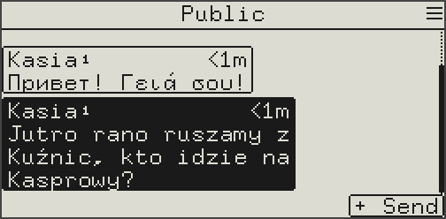
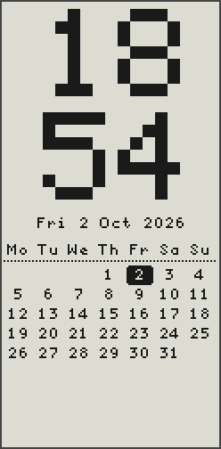
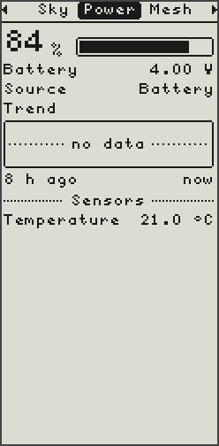
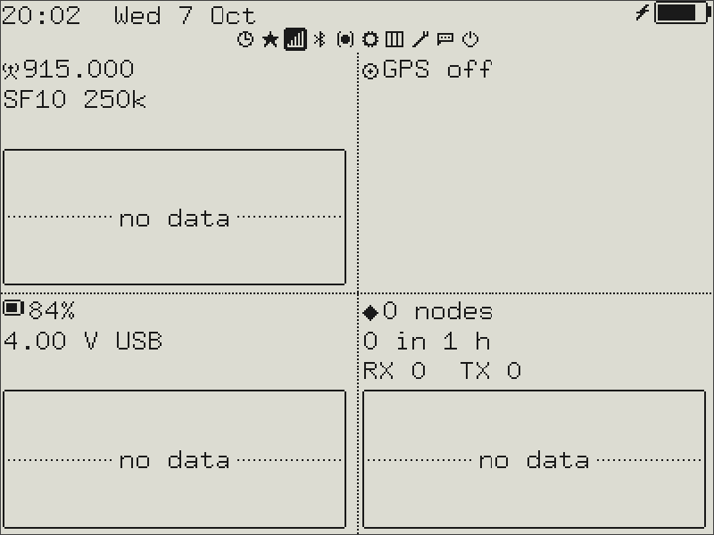

# Hardware

## External keyboard and joystick

Two optional add-ons, detected at boot; a build with them enabled works the
same with nothing plugged in.

| Device | CardKB | Wired joystick |
| ------ | :----: | :------------: |
| Wio Tracker L1 (OLED / e-ink) | Grove connector | built in |
| GAT562 30S Mesh Kit | — | built in |
| Heltec V3 / V4 | soldered (below) | soldered (below) |
| ProMicro | on the main I2C bus (required: it has no buttons) | — |
| Cardputer ADV, T-Echo Lite + KeyShield, Simpson | built-in keyboard instead | — |

### CardKB

An M5Stack CardKB types straight into any text field. It sends plain
characters, so the keyboard alphabet settings don't apply to it.

| Key | Does |
| --- | ---- |
| Arrows, Enter, Esc | Same as the joystick, Enter and Back |
| Backspace | Deletes before the cursor |
| **Fn+Enter** | Submits the field |
| **Fn+letter** | Accents for that letter (Fn+A → á à ä…) |
| **Tab** | Hold Enter (options menus) |
| **Fn+Esc** | Locks / unlocks the screen |

Settings › Keyboard › **Ext. KB**: **Full** keeps the on-screen grid, so the
CardKB and the joystick can be mixed; **Compact** hides it, the arrows move the
text cursor and Enter submits. Compact needs no joystick at all.

### Wired joystick

Four direction contacts and a press contact (Enter), each shorted to ground
when pressed; the firmware enables the pull-ups, so no resistors are needed.
The board's own button becomes Back. Settings › Display › **Joystick
rotation** turns the directions for a stick mounted sideways.

### Wiring on the Heltec V3 / V4

Neither board has a joystick or a keyboard connector, so both are soldered to
free pins. V3 and V4 use the same pins (confirmed on a V4).

| Function | GPIO |
| -------- | :--: |
| CardKB SDA / SCL | 3 / 4 (second I2C bus, not the display's) |
| Joystick up / down / left / right | 23 / 6 / 47 / 48 |
| Joystick press (Enter) | 33 |
| Back | 0 (the PRG button, nothing to wire) |

The pins are set in [`solo/heltec_v3/platformio.ini`](../../solo/heltec_v3/platformio.ini)
and [`solo/heltec_v4/platformio.ini`](../../solo/heltec_v4/platformio.ini).
For a CardKB-only build, comment out the joystick block there and use
Ext. KB = Compact.

### Built-in keyboards

The Cardputer ADV has a QWERTY keyboard, the T-Echo Lite a T9 keypad on its
KeyShield add-on (without it the board has no usable input). Their keymaps
are in each board's driver under `variants/`; they don't follow the CardKB's
Fn shortcuts.

## E-ink

The e-ink Wio Tracker L1 comes in four builds, one per screen and
orientation, since every screen is laid out for one shape:

- **Landscape** (250 × 122) writes in a larger 8 × 13 font, with larger icons.
- **Portrait** (250 × 122) keeps the 6 × 9 font and fits more lines.
- **4.2"** (400 × 300, Good Display GDEY042T81, on the same wiring in place of
  the 2.13") writes in a 9 × 15 font with its own icon set, and uses the
  room for tiles on the status page, a node list with a detail pane, charts,
  the sky view and the clock tools.
- **4.26"** (800 × 480, Good Display GDEQ0426T82, on the board's 24-pin e-ink
  connector) writes in the 4.2"'s 9 × 15 font at twice the size and lays its
  screens out the same way. 250 contacts and 32 queued messages, since the
  panel's image takes 48 KB of memory.

| Landscape | Portrait | |
| :---: | :---: | :---: |
|  |  |  |

| 4.2" |
| :---: |
|  |

The e-ink screens show more than the OLED, the portrait one most:

- a month calendar (portrait) under the clock and on the lock screen, the
  alarm's days marked;
- whole message bubbles;
- charts of the last 8 hours on the Status screen;
- a compass rose and the path's hops on a contact's details, and direction
  arrows in the node list;
- under a saved trail (portrait), its map and elevation profile.

Hibernating leaves **Powered off** on the screen, and it stays there even if
you then use the power switch. The switch alone cuts the board with no warning,
so the screen goes grey or dark soon after: hibernate first to keep it clean.

Settings › Display has a few settings of its own:

- **Rotation** turns the screen upside down; the joystick turns with it.
- **Joystick** rotation, for a joystick mounted another way.
- **Full rfsh**: how many partial updates between full ones, against
  ghosting.
- **Text size** and **Icon size** (4.26" only): the text and the status
  bar's icons, larger or smaller.

The panel refreshes only when what it shows changes. Times are shown to the
minute (no seconds counting up), and clock seconds are hidden by default.

## Simpson

A DIY board by [sim1988son](https://github.com/sim1988son), an extended
FakeTec: a ProMicro nRF52840 with a RA-01S (SX1262) radio, an ATGM336H GPS,
a 1.3" SH1106 OLED, a 4×4 keypad on a PCF8574 I2C expander (address 0x20),
a buzzer and a vibration motor. The GPS, the buzzer and the motor are each
switched by a MOSFET.

The schematic as a PDF: [simpson-schematic.pdf](./hardware/simpson-schematic.pdf).
The build is `solo-<version>-Simpson.uf2`; pins are in
[`variants/simpson`](../../variants/simpson).

### The keypad

**Fn** steps through four modes, shown in the corner of a text field and as
an alert: **Ctl** (navigation), **abc**, **ABC** and **123**. Bluetooth, GPS
and the brightness keys do the same in every mode.

Ctl:

| | | | |
| :-: | :-: | :-: | :-: |
| Back | Up | — | Bluetooth page |
| Left | Enter | Right | Brightness + |
| Symbols | Down | — | Brightness − |
| Messages | — | **Fn** | Status page |

abc / ABC (T9: pressing a key again cycles its letters) and 123:

| | | | |
| :-: | :-: | :-: | :-: |
| `.,?!` / 1 | ABC / 2 | DEF / 3 | Bluetooth page |
| GHI / 4 | JKL / 5 | MNO / 6 | Brightness + |
| PQRS / 7 | TUV / 8 | WXYZ / 9 | Brightness − |
| Backspace | Space / 0 | **Fn** | Status page |

Symbols opens the keyboard's symbols page while a text field is open.

## Wio Tracker L2

- **Buttons**: the top one turns the screen off and on; the side one goes
  home, and held and let go mutes the sound. Side + top takes a screenshot
  (a BMP in `screenshots/` on the SD card); the site's USB tools take one over
  USB.
  Holding the side button in the first seconds after power-on starts the CLI
  rescue on USB serial.
- **SD card**: holds the message history, maps, GPX trails and live map tiles.
  Settings › Storage shows what takes the space, how many messages each
  conversation keeps, and deletes the history.
- **USB drive**: plugged into a computer, the device asks whether to keep the
  SD card or lend it to the computer. Charging and the USB connection (the
  site's USB tools, the app) work either way. While lent, the device can't use
  the card; eject it on the computer and the device restarts. With a screen
  PIN set, it doesn't ask until the screen is unlocked.
- **WiFi**: used only for map downloads, live tiles and updates, and off the
  rest of the time. Settings › WiFi saves several networks and joins the
  strongest; the WiFi switch in Settings forbids it entirely.

## Build flags

Extra hardware (a buzzer, a vibration motor, a Hall sensor for a magnetic
cover, GPIO, an external PA) is enabled with build flags in your own
`solo/<board>/platformio.ini`; see [Build flags](./developer/build-flags.md).
